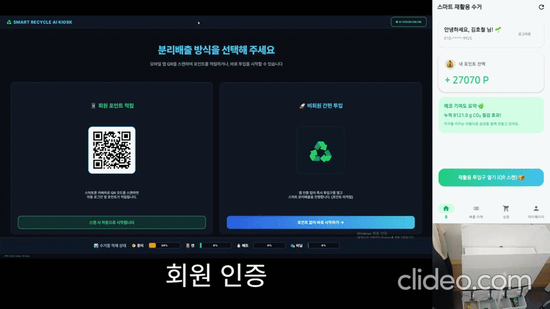
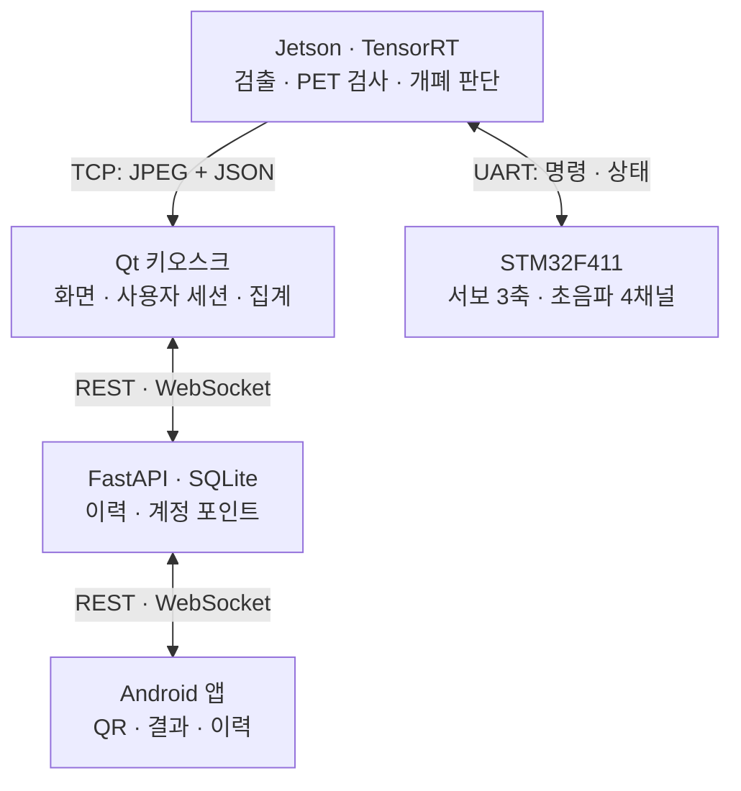

# Smart Recycling Edge AI

재활용품 4종의 재질 인식과 PET 라벨·내용물 검사를 수행하고, STM32 분류 기구와 Qt 키오스크·Android 보상 흐름을 연동한 스마트 분리수거 프로젝트입니다.

**Jetson Orin Nano · STM32F411 · C/C++ · Python · Qt · FastAPI · Android**

## 통합 시연

[전체 시연 영상](https://github.com/user-attachments/assets/a7b54b54-8b72-4728-b04c-dced2dc5ca10) · [시스템 구조](docs/architecture.md) · [실행 안내](docs/getting-started.md) · [기술 문서](docs/README.md)

QR로 사용자를 연결하고, 재질·PET 상태 판정에 따라 분류 기구를 구동합니다. 키오스크에서 투입을 마치면 집계 결과를 서버에 저장하고 앱에 전달합니다. 비회원 배출도 지원합니다.

## 팀 구성과 개발 역할

- **김호철 · 시스템 소프트웨어:** 아키텍처·통신 프로토콜 설계, Jetson 추론·도어 제어 파이프라인, Qt·서버·Android 연동 및 통합
- **권민지 · AI 모델:** 재질 검출 모델 학습·비교, PET 라벨·내용물 검사 모델 구성
- **석민정 · MCU 제어:** 초음파 계측·필터링, 서보 동작 순서와 제어 파라미터 튜닝
- **현수근 · 하드웨어:** 키오스크 기구 설계·제작, 서보 브래킷과 배출 통로 보강

## 시스템 구조

| 구성 | 책임 | 상세 문서 |
| --- | --- | --- |
| Jetson | 4종 재질 검출, PET 상태 검사, 자동 개폐 판단, 영상·상태 전송 | [엣지 파이프라인](edge_jetson/README.md) |
| STM32 | 분류 경로·도어 구동, 적재율 계측, 최대 개방 시간 제한 | [MCU 펌웨어](mcu_firmware/README.md) |
| Qt | 영상·검사 결과 표시, 사용자 세션, 수량·포인트 집계 | [키오스크](pc_dashboard/README.md) |
| FastAPI | 사용자·배출 이력 저장, 포인트 갱신, 기기 간 이벤트 중계 | [서버](server/README.md) |
| Android | QR 연결, 배출 결과·이력 조회, 포인트 사용 시연 | [모바일 앱](mobile_app/README.md) |
| AI 실험 | 데이터 준비, 모델 비교·평가, ONNX 내보내기 | [학습과 평가](ai_models/Readme.md) |

## 핵심 설계

### 1. 분류판을 먼저 정렬하는 MCU 제어

상단 도어와 하단 분류판을 동시에 움직이면 통로가 정렬되기 전에 물체가 떨어질 수 있습니다. 하단 두 축의 소프트웨어 각도 램프가 끝난 뒤 상단 도어를 구동하도록 순서를 나눴습니다.

서보는 120°/s 램프로 제어합니다. MCU는 개방 명령 처리 시점부터 2초 이내의 닫힘 요청을 보류하고, 10초가 지나면 자체적으로 중립 복귀를 요청합니다. 적재율에는 투입 명령 후 블랭킹, 이상치 제거 평균, 데드밴드를 적용했습니다.

[분류 제어 구현](mcu_firmware/recycle.c) · [센서 필터](mcu_firmware/bin_filter.c) · [설계 설명](docs/troubleshooting.md#분류-통로의-선행-정렬)

### 2. 추론 장치와 화면을 분리한 영상 전송

Jetson은 추론과 제어를 담당하고 Qt가 화면을 렌더링합니다. JPEG와 같은 프레임의 검출 결과를 `8바이트 길이 헤더 + JPEG + JSON`으로 묶어 전송합니다. Qt는 TCP 수신 조각을 누적하고 전체 메시지가 도착했을 때 해석합니다.

카메라 캡처와 UART 수신은 별도 스레드에서 처리합니다. TensorRT 입출력 버퍼는 초기화 때 확보해 재사용하며, 추론 결과를 사용할 때 CUDA 스트림을 동기화합니다.

[송신 구현](edge_jetson/stream/socket_server.py) · [수신 구현](pc_dashboard/network/jetson_client.cpp) · [통신 규약](docs/protocol-spec.md)

### 3. 인식 흔들림과 장치 상태를 고려한 집계

Jetson은 인식 유지 시간과 유효 프레임 수를 함께 확인하고, 짧은 검출 누락은 유예합니다. PET에는 재질 검출 후 라벨·내용물 분류기를 추가 적용합니다.

Qt는 검출 프레임마다 수량을 올리는 대신, 활성 사용자 세션에서 MCU가 보고한 도어 상태의 `CLOSED → OPEN` 전이마다 한 번 집계합니다. 집계한 수량·보상을 REST로 제출하고, 서버는 앱에 완료 이벤트를 보냅니다.

[도어 FSM](edge_jetson/core/door_controller.py) · [집계 구현](pc_dashboard/controllers/recycle_session_controller.cpp) · [전체 상태 흐름](docs/architecture.md)

## 구현 결과와 확장 과제

- 종이·캔·PET·비닐 분류, PET 라벨·내용물 검사, 3축 분류 기구와 4구역 적재율 표시를 연결했습니다.
- 회원 QR 연결·비회원 이용·완료 정산·양측 세션 취소·앱 배출 이력·포인트 차감 흐름을 구성했습니다.
- PET 분류기 저장 평가 결과는 각 Test 61장 기준 라벨 61/61, 내용물 56/61 정분류입니다. [평가 조건과 모델별 결과](ai_models/Readme.md#저장된-평가-결과)를 함께 확인할 수 있습니다.

현재 수량 집계는 도어 제어 상태를 기준으로 하며 실제 낙하·서보 도착을 센서로 확인하지 않습니다. 운영 확장 과제는 실제 투입 확인, 사용자·기기 인증, 중복 정산 방지와 정산 트랜잭션 통합입니다. 실제 카메라 FPS와 화면 표시까지의 지연은 별도 측정이 필요합니다.

## 문서와 실행

- [전체 시스템 실행 안내](docs/getting-started.md): 장치·모델 준비, 주소 설정, 구동 순서와 확인 절차
- [시스템 아키텍처](docs/architecture.md): 실행 구조, 데이터 소유권, 정상·취소 흐름과 구현 범위
- [통신 프로토콜](docs/protocol-spec.md): TCP·UART·REST·WebSocket 메시지 명세
- [설계와 트러블슈팅](docs/troubleshooting.md): 영상 전송, 모터 제어, 센서·시리얼 처리
- [프로젝트 발표자료](docs/presentation/smart_recycling_final_report.pdf): 발표 당시 구성·실험·시연 기록

모델 가중치·TensorRT 엔진·원본 데이터는 저장소에 포함하지 않습니다. 실행에 필요한 파일과 준비 조건은 각 모듈 문서에 정리했습니다. 발표자료의 과거 수치와 현재 코드 설정·저장된 실험 출력은 구분해 표기합니다.

## 외부 코드와 출처

QR 생성에는 [Nayuki QR Code Generator](pc_dashboard/utils/qrcodegen.hpp)를 사용하며, STM32/CMSIS 헤더와 함께 원본 라이선스·저작권 표기를 유지합니다. 저장소 전체에 적용하는 별도 라이선스 파일은 현재 없습니다.
