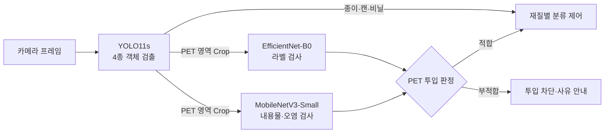
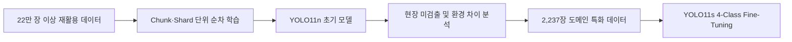

# ♻️ Smart Recycling Edge AI Models

**대규모 재활용 데이터 학습에서 실제 키오스크 환경 특화 학습까지**  
**재질 검출과 PET 상태 검사를 연결한 실시간 자원순환 비전 AI**

---

## 📖 프로젝트 개요 (Overview)

**Smart Recycling Edge AI Models**는 **Smart Recycling Edge AI Kiosk** 프로젝트의 비전 AI 영역입니다. 카메라에 보이는 재활용품을 종이(Paper), 캔(Can), 페트(PET), 비닐(Vinyl)로 검출하고, PET에 대해서는 라벨이 붙어 있는지와 내용물이 남아 있는지를 별도로 검사합니다. 이 결과를 이용해 정상 투입을 허용하거나 부적합 사유를 안내합니다.

처음에는 22만 장 이상의 대규모 재활용 데이터와 경량 YOLO11n으로 범용 특징을 학습했습니다. 그러나 실제 키오스크 내부에서 미검출이 발생해, 장치 내부 촬영 이미지가 약 80%인 2,237장 데이터로 **YOLO11s를 Fine-Tuning**했습니다. 이어서 PET의 두 상태를 각각 비교 평가하여 **라벨 검사에는 EfficientNet-B0**, **내용물·오염 검사에는 MobileNetV3-Small**을 선택했습니다.

### 핵심 결과

| 대상 | 모델 | 평가 결과 | 평가 구분 |
| :--- | :--- | :--- | :--- |
| 픽셀 단위 객체 분할 | **YOLO11s-seg** | Mask mAP50 **99.5%**, Mask mAP50-95 **94.3%** | Validation 359장 |
| 대용량 데이터 검출 | **YOLO11n** | Box mAP50 **54.4%**, Box mAP50-95 **41.2%** | Test 1,999장 |
| 장치 환경 특화 검출 | **YOLO11s** | Box mAP50 **98.7%**, Box mAP50-95 **91.9%** | 제공된 617장 평가 화면 |
| PET 라벨 부착 여부 | **EfficientNet-B0** | 61/61 정분류, Accuracy·F1 **100%** | Test 61장 |
| PET 내용물·오염 여부 | **MobileNetV3-Small** | 56/61 정분류, Accuracy **91.80%**, F1 **92.31%** | Test 61장 |
| 전체 파이프라인 | TensorRT 기반 3-Model 2-Stage | 지연 시간 **14.1 ms**, 전송 개선 후 **60 FPS급** | 시스템 측정 |

> 위 값은 서로 다른 데이터와 지표에서 측정되었습니다. 특히 대용량 YOLO11n과 도메인 특화 YOLO11s의 차이는 동일한 평가셋에서의 순수 성능 향상폭이 아닙니다. 

---

## 🏗 비전 AI 아키텍처 (3-Model 2-Stage Architecture)

하나의 모델에 재질과 상태 판정을 모두 맡기지 않고, 전체 화면에서 빠르게 객체를 찾는 **Stage 1**과 PET Crop을 정밀하게 검사하는 **Stage 2**를 분리했습니다. **Paper·Can·Vinyl은 Stage 1의 재질 판별 결과로 해당 수거함에 분류**하고, **PET만 Stage 2 품질 검사를 통과한 뒤 PET 수거함에 분류**합니다.

| 구분 | 입력 | 처리 | 출력 |
| :--- | :--- | :--- | :--- |
| **Stage 1** | 전체 프레임, 640 × 640 | YOLO11s 객체 검출 | 4종 Class, Confidence, BBox |
| **Stage 2-A** | PET BBox Crop, 224 × 224 | EfficientNet-B0 이진 분류 | 라벨 부착 여부 |
| **Stage 2-B** | PET BBox Crop, 224 × 224 | MobileNetV3-Small 이진 분류 | 내용물·오염 여부 |

**YOLO11s-seg는 비교·검토한 별도 실험**입니다. 최종 운영 파이프라인에는 Mask 생성을 넣지 않았습니다.

---

## 🧩 모델 선정 과정 (Model Selection)

### 1. YOLO11s-seg: 정밀한 Mask가 필요한가?

Stage 1 설계 초기에 YOLO11s-seg로 재활용품의 종류와 픽셀 단위 객체 영역을 함께 추출했습니다. **832 × 832 입력과 AdamW**로 학습했고, 발표 슬라이드는 추론 입력을 **640 × 640**으로 표기합니다. 이는 실험 설정이며 최종 시스템에 Segmentation을 채택했다는 뜻은 아닙니다. CAN, PAPER, PET의 Mask를 분리한 시각적 결과도 확인할 수 있습니다.

그러나 실제 키오스크의 분류 제어에는 객체의 **종류와 위치**가 핵심 입력이었습니다. 정확한 외곽선보다 BBox를 빠르게 얻는 편이 60 FPS급 엣지 처리 목표에 맞았고, Segmentation의 추가 연산을 피하기 위해 최종 Stage 1은 Detection 중심으로 구성했습니다.

| 실험 | 얻은 결과 | 최종 판단 |
| :--- | :--- | :--- |
| YOLO11s-seg | CAN·PAPER·PET 영역을 Mask로 분리한 시각적 결과 | 연구·비교 실험으로 유지 |
| YOLO11s Detection | 4종 재활용품의 위치와 종류를 BBox로 제공 | **운영 Stage 1에 채택** |

#### 📷 Segmentation 결과

| CAN Mask | PAPER Mask | PET Mask | VINYL Mask|
| :---: | :---: | :---: |  :---: |
|  |  |  |  |

<!-- 이미지 파일 추가 후 위 표의 각 셀을 예시처럼 교체:

-->

| 데이터·모델 | 평가셋 | 이미지 수 | Box mAP50 | Box mAP50-95 | Mask mAP50 | Mask mAP50-95 | 운영 역할 |
| :--- | :--- | ---: | ---: | ---: | ---: | ---: | :--- |
| YOLO11s-seg | Validation | **359** | **99.5%** | **96.6%** | **99.5%** | **94.3%** | 연구·비교 실험 |

| 클래스 | 이미지 / 인스턴스 | Box P | Box R | Box mAP50-95 | Mask P | Mask R | Mask mAP50-95 |
| :--- | ---: | ---: | ---: | ---: | ---: | ---: | ---: |
| **전체** | **359 / 359** | **99.7%** | **100%** | **96.6%** | **99.7%** | **100%** | **94.3%** |
| Paper | 100 / 100 | 99.7% | 100% | 97.7% | 99.7% | 100% | 96.7% |
| Can | 100 / 100 | 99.7% | 100% | 98.3% | 99.7% | 100% | 96.4% |
| PET | 73 / 73 | 99.8% | 100% | 92.5% | 99.8% | 100% | 90.0% |
| Vinyl | 86 / 86 | 99.8% | 100% | 97.8% | 99.8% | 100% | 94.1% |

**해석:** 4종 모두 Mask mAP50이 99.5%입니다. 다만 키오스크의 분류 제어에 필요한 것은 재질과 위치여서, 운영 Stage 1에는 BBox 기반 Detection을 사용했습니다.

### 2. YOLO11n: 대규모 데이터로 범용 특징 학습

초기 실험에는 **22만 장 이상**의 재활용 이미지와 경량 **YOLO11n**을 사용했습니다. 발표 자료에 제시된 클래스별 규모는 **PET 약 7.2만, CAN 약 9.5만, PAPER 약 4만, VINYL 약 1.6만**입니다. 대용량 데이터를 한 번에 처리하지 않고 **Chunk와 Shard 단위로 분할해 순차 학습**했으며, 각 단계의 검증 결과를 비교해 가장 좋은 가중치를 보존했습니다.

| 데이터·모델 | 평가 | 결과 | 현장 관찰 |
| :--- | :--- | :--- | :--- |
| 22만 장 이상 재활용 데이터 / YOLO11n | Test 1,999장 | Box P **51.7%**, R **60.6%**, mAP50 **54.4%**, mAP50-95 **41.2%** | 실제 장치 내부에서 일부 객체 미검출 |

| 클래스 | 이미지 / 인스턴스 | Box P | Box R | Box mAP50 | Box mAP50-95 |
| :--- | ---: | ---: | ---: | ---: | ---: |
| **전체** | **1,999 / 1,999** | **51.7%** | **60.6%** | **54.4%** | **41.2%** |
| PET | 500 / 500 | 55.9% | 66.0% | 59.4% | 45.5% |
| Can | 500 / 500 | 51.2% | 69.4% | 59.5% | 52.1% |
| Paper | 345 / 345 | 45.4% | 58.3% | 48.1% | 32.5% |
| Vinyl | 654 / 654 | 54.2% | 48.6% | 50.5% | 34.7% |

#### 📷 YOLO11n 검출 결과: Domain Gap

| 학습 데이터와 비슷한 장면 | 실제 키오스크 내부 장면 |
| :---: | :---: |
|  | |

<!-- 실제 이미지 경로 예시: docs/assets/models/yolo11n_in_domain.png,
     docs/assets/models/yolo11n_kiosk_miss.png -->

위와 같이 일반 캔은 잘 검출하는데 실제 키오스크 내부에 사진인 캔은 검출하지 못합니다. 데이터 **양**보다 실제 배포 환경과의 **분포 일치**가 중요하다는 판단에 따라 다음 실험을 설계했습니다.

### 3. YOLO11s: 장치 환경에 맞춘 4-Class Fine-Tuning

최종 검출 데이터는 **2,237장**이며, 약 **80%**를 장치 내부에서 여러 각도로 직접 촬영한 도메인 특화 이미지, 나머지 약 **20%**를 재활용 데이터로 구성했습니다. **Train 1,791장 / Validation 446장**으로 분할했습니다. 모델은 YOLO11n에서 **YOLO11s**로 바꾸고 Paper, Can, PET, Vinyl의 4개 클래스로 Fine-Tuning했습니다.

학습 설정은 **832 × 832 입력, 200 Epoch, AdamW**입니다. 회전·크기·색상 변화와 Mosaic 증강을 적용했으며, 실제 검출 파이프라인에는 **640 × 640 입력**을 사용했습니다.

| 데이터·모델 | 평가 | mAP50 | mAP50-95 | 운영 역할 |
| :--- | :--- | ---: | ---: | :--- |
| 2,237장 / YOLO11s | 기존 Validation 446장 | **99.49%** | **93.86%** | 재질 검출, PET ROI Crop 제공 |
| 도메인 특화 YOLO11s | 이번 제공 화면의 617장 평가 | **98.7%** | **91.9%** | 별도 평가 결과 |

이번 제공 화면에는 617장의 **평가셋 명칭이 표시되지 않아** Test 또는 Validation으로 임의 지정하지 않았습니다.

| 클래스 | 이미지 / 인스턴스 | Box P | Box R | Box mAP50 | Box mAP50-95 |
| :--- | ---: | ---: | ---: | ---: | ---: |
| **전체** | **617 / 617** | **92.3%** | **96.3%** | **98.7%** | **91.9%** |
| Paper | 142 / 142 | 97.3% | 100% | 99.5% | 94.2% |
| Can | 152 / 152 | 96.9% | 99.3% | 99.5% | 95.7% |
| PET | 173 / 173 | 76.5% | 100% | 97.8% | 87.4% |
| Vinyl | 150 / 150 | 98.5% | 85.9% | 98.2% | 90.3% |

**해석:** 높은 전체 mAP50과 함께 PET Precision **76.5%**, Vinyl Recall **85.9%**를 후속 개선 대상으로 확인했습니다.

#### 📷 YOLO11s 검출 결과: 장치 환경 특화

| 4종 재활용품 BBox 예시 | PET 검출 후 Crop 예시 |
| :---: | :---: |
|  |  |

<!-- 실제 이미지 경로 예시: docs/assets/models/yolo11s_four_classes.png,
     docs/assets/models/yolo11s_pet_crop.png -->

YOLO11n의 1,999장 Test와 YOLO11s의 446장 Validation·617장 평가는 데이터가 다릅니다. 따라서 54.4%와 99.49% 또는 98.7%의 차이를 하나의 변경만으로 얻은 순수 성능 향상이라고 표현하지 않습니다. 같은 현장 홀드아웃 데이터에서 두 모델을 비교하면 개선 효과를 더 직접적으로 확인할 수 있습니다.

### 4. PET 멀티 라벨 목적 검사: 실제 선별 결과와 모델 선택

PET는 재질이 맞더라도 **라벨이 붙어 있거나 내용물이 남아 있으면 투입을 차단**해야 합니다. 한 장의 PET 이미지에서 두 상태를 함께 확인하기 위해 라벨 검사와 내용물·오염 검사를 구성했습니다. 실제 구현은 **단일 멀티 라벨 모델이 아니라 독립적인 이진 분류기 2개**이며, MobileNetV3-Small·EfficientNet-B0·ResNet18을 각 검사 작업에서 비교했습니다.

비교 모델은 3채널 **224 × 224** 입력과 ImageNet 사전학습 Backbone을 사용했습니다. Backbone 뒤에 Global Average Pooling, 128차원 Dense 층, Dropout, Sigmoid 이진 분류기를 두었고, 검증 결과로 가중치를 선택한 뒤 Test 성능을 별도로 확인했습니다.

#### 📷 실제 선별 사례: 라벨은 없지만 내용물이 남은 PET

아래 사진은 라벨이 없는 PET 병에 내용물이 남아 있는 사례입니다. 세 Backbone 모두 **라벨 `없음`·내용물 `있음`**으로 예측했고, 최종 선별 결과는 **불통과 — 내용물 비우기 필요**로 일치했습니다.

아래 사진은 라벨이 있는 PET 병에 내용물이 없는 사례입니다. 세 Backbone 모두 **라벨 `있음`·내용물 `없음`**으로 예측했고, 최종 선별 결과는 **불통과 — 라벨 제거 필요**로 일치했습니다.

| Backbone | 라벨 예측 | 라벨 있음 확률 | 내용물 예측 | 내용물 있음 확률 | 선별 결과 |
| :--- | :---: | ---: | :---: | ---: | :---: |
| MobileNetV3-Small | 있음 | 99.2% | 없음 | 13.1% | 불통과 |
| EfficientNet-B0 | 있음 | 99.7% | 없음 | 11.6% | 불통과 |
| ResNet18 | 있음 | 99.6% | 없음 | 21.4% | 불통과 |

| Backbone | 라벨 예측 | 라벨 있음 확률 | 내용물 예측 | 내용물 있음 확률 | 선별 결과 |
| :--- | :---: | ---: | :---: | ---: | :---: |
| MobileNetV3-Small | 없음 | 28.4% | 있음 | 53.5% | 불통과 |
| EfficientNet-B0 | 없음 | 4.8% | 있음 | 64.5% | 불통과 |
| ResNet18 | 없음 | 44.7% | 있음 | 90.0% | 불통과 |

**운영 파이프라인의 판정:** 라벨 검사에 채택한 **EfficientNet-B0**는 라벨에 대해서는 있음 확률을 **99.7%**로, 내용물 검사에 채택한 **MobileNetV3-Small**은 내용물 있음 확률을 **53.5%**로 출력했습니다. 라벨은 없지만 내용물이 있다고 판단되어 투입을 차단합니다. 같은 판정을 낸 세 모델의 확률은 서로 다르므로, 개별 예측 확률을 모델 전체의 정확도로 해석하지 않습니다.

> 이 화면은 **PET 한 장의 추론 사례**입니다. 아래 61장 Test 성능은 별도 평가 결과입니다.

#### 61장 Test 비교: 라벨 부착 여부

| Backbone | Accuracy | Precision | Recall | F1 | ROC AUC | TN / FP / FN / TP | 결정 |
| :--- | ---: | ---: | ---: | ---: | ---: | :---: | :--- |
| MobileNetV3-Small | 98.36% | 96.88% | 100% | 98.41% | 99.78% | 29 / 1 / 0 / 31 | 비교 모델 |
| **EfficientNet-B0** | **100%** | **100%** | **100%** | **100%** | **100%** | **30 / 0 / 0 / 31** | **최종 라벨 모델** |
| ResNet18 | 96.72% | 100% | 93.55% | 96.67% | 99.57% | 30 / 0 / 2 / 29 | 비교 모델 |

EfficientNet-B0는 이 Test에서 **61/61 정분류**, FP·FN **0건**으로 라벨 검사에 선택했습니다. 100%는 해당 표본에서 관측된 값이며 모든 촬영 환경에서의 무오류를 뜻하지 않습니다.

#### 61장 Test 비교: 내용물·오염 여부

| Backbone | Accuracy | Precision | Recall | F1 | ROC AUC | TN / FP / FN / TP | 결정 |
| :--- | ---: | ---: | ---: | ---: | ---: | :---: | :--- |
| **MobileNetV3-Small** | **91.80%** | **93.75%** | **90.91%** | **92.31%** | 93.51% | 26 / 2 / 3 / 30 | **최종 내용물·오염 모델** |
| EfficientNet-B0 | 88.52% | 88.24% | 90.91% | 89.55% | 94.59% | 24 / 4 / 3 / 30 | 비교 모델 |
| ResNet18 | 88.52% | 90.63% | 87.88% | 89.23% | 92.64% | 25 / 3 / 4 / 29 | 비교 모델 |

MobileNetV3-Small은 세 후보 중 Accuracy·F1이 가장 높고 오류가 **FP 2건·FN 3건**으로 가장 적어 내용물 검사에 선택했습니다. 같은 PET Crop을 두 모델에 전달한 뒤, **라벨과 내용물이 모두 적합할 때만** 투입을 허용합니다.

### 📊 실험 모델과 운영 모델 구분

| 모델 | 수행한 실험·역할 | 운영 반영 |
| :--- | :--- | :---: |
| YOLO11s-seg | Mask 기반 객체 분할 검토 | 아니요 |
| YOLO11n | 22만 장 이상 데이터의 초기 Detection 학습 | 아니요 |
| **YOLO11s** | 장치 환경 특화 Detection | **예** |
| **EfficientNet-B0** | 라벨·내용물 Backbone 비교 | **라벨 검사** |
| **MobileNetV3-Small** | 라벨·내용물 Backbone 비교 | **내용물 검사** |
| ResNet18 | 라벨·내용물 Backbone 비교 | 아니요 |

---

## 📊 모델별 실험 수치 기록표 (Benchmark Details)

발표 대본과 22장짜리 상세 PPT에서 확인되는 수치를 먼저 채웠습니다. `입력 필요`는 **실제 학습 로그나 평가 결과에서 직접 확인할 값**이며 임의의 추정치가 아닙니다. 같은 태스크의 후보 모델을 비교할 때는 평가 데이터, 클래스 정의, 입력 크기를 통일해 기록합니다.

### Detection 비교

| 모델·실험 | 평가셋 | 이미지 수 | Precision | Recall | mAP50 | mAP50-95 | 
| :--- | :--- | ---: | ---: | ---: | ---: | ---: |
| YOLO11n · 대규모 데이터 | Test | **1,999** | **51.7%** | **60.6%** | **54.4%** | **41.2%** |
| YOLO11s · 도메인 특화 | Validation | **446** | **99.3%** | **99.5%** | **99.49%** | **93.86%** |
 

### Segmentation 비교

| 모델 | 평가셋 | 이미지 수 | Mask Precision | Mask Recall | Mask mAP50 | Mask mAP50-95 |
| :--- | :--- | ---: | ---: | ---: | ---: | ---: | 
| YOLO11s-seg | Validation | **359** | **99.7%** | **100%** | **99.5%** | **94.3%** |

### PET 라벨 검사: 동일 Test 데이터 비교

| Backbone | Test 이미지 수 | Accuracy | Precision | Recall | F1 | FP / FN |
| :--- | ---: | ---: | ---: | ---: | ---: | :---: | 
| **EfficientNet-B0** | **61** | **100%** | **100%** | **100%** | **100%** | **0 / 0** |
| MobileNetV3-Small | **61** | **98.36%** | **96.88%** | **100%** | **98.41%** | **1 / 0** | 
| ResNet18 | **61** | **96.72%** | **100%** | **93.55%** | **96.67%** | **0 / 2** | 

### PET 내용물·오염 검사: 동일 Test 데이터 비교

| Backbone | Test 이미지 수 | Accuracy | Precision | Recall | F1 | FP / FN | 모델 크기·지연 |
| :--- | ---: | ---: | ---: | ---: | ---: | :---: | :--- |
| **MobileNetV3-Small** | **61** | **91.80%** | **93.75%** | **90.91%** | **92.31%** | **2 / 3** | 입력 필요 |
| EfficientNet-B0 | **61** | **88.52%** | **88.24%** | **90.91%** | **89.55%** | **4 / 3** | 입력 필요 |
| ResNet18 | **61** | **88.52%** | **90.63%** | **87.88%** | **89.23%** | **3 / 4** | 입력 필요 |

### 데이터 분포 

최종 Detection 데이터는 **총 2,237장, Train 1,791장, Validation 446장**입니다. 대규모 데이터의 클래스별 규모는 PET 약 7.2만, CAN 약 9.5만, PAPER 약 4만, VINYL 약 1.6만으로 상세 PPT에 제시됩니다. 

---

## 🗃️ 대용량 데이터와 도메인 특화 학습 (Data Strategy)

이 프로젝트의 데이터 전략은 **범용 데이터로 넓은 특징을 학습한 실험**과 **실제 키오스크 환경에 맞춘 별도 Fine-Tuning 실험**으로 나뉩니다.

| 데이터셋 | 확인된 규모·구성 | 사용 목적 | 추가로 필요한 공개 정보 |
| :--- | :--- | :--- | :--- |
| 대규모 재활용 데이터 | **22만 장 이상**, PET 약 7.2만 / CAN 약 9.5만 / PAPER 약 4만 / VINYL 약 1.6만 | YOLO11n 범용 특징 학습 | 출처, Train/Val/Test 분할과 중복 기준 |
| 장치 환경 특화 데이터 | **2,237장**, 약 **80%** 장치 내부 촬영 / 약 **20%** 재활용 데이터, Train **1,791** / Val **446** | YOLO11s 4종 Fine-Tuning | 클래스별 수량, 별도 Test 존재 여부 |
| PET 라벨 분류 데이터 | **Test 61장**, 전체 학습·검증 수량 미기재 | 3개 Backbone 비교 | 라벨 있음/없음 수량과 Train/Val 규모 |
| PET 내용물·오염 데이터 | **Test 61장**, 전체 학습·검증 수량 미기재 | 3개 Backbone 비교 | 정상/오염 수량과 Train/Val 규모 |

대용량 학습에서 확인되는 처리 방법은 **Chunk·Shard 분할, 순차 학습, 단계별 검증 및 최적 가중치 보존**입니다. 최종 YOLO11s Fine-Tuning에서는 **회전·크기·색상 변화와 Mosaic 증강**을 진행하였습니다.

---
