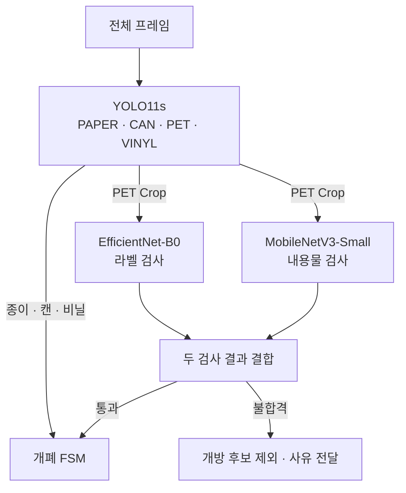
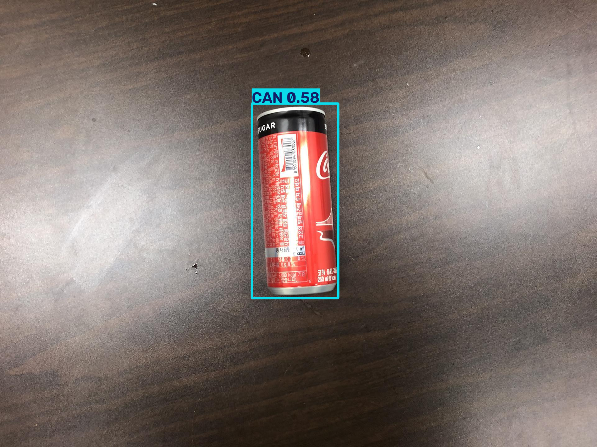
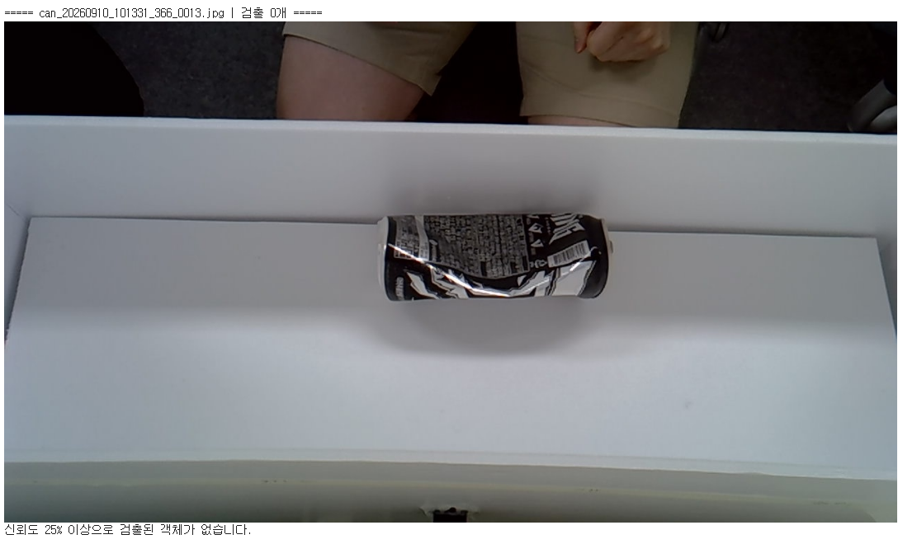
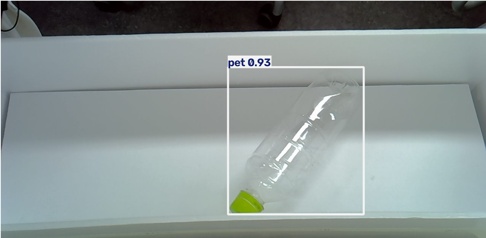
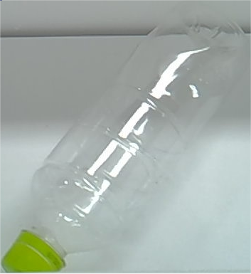
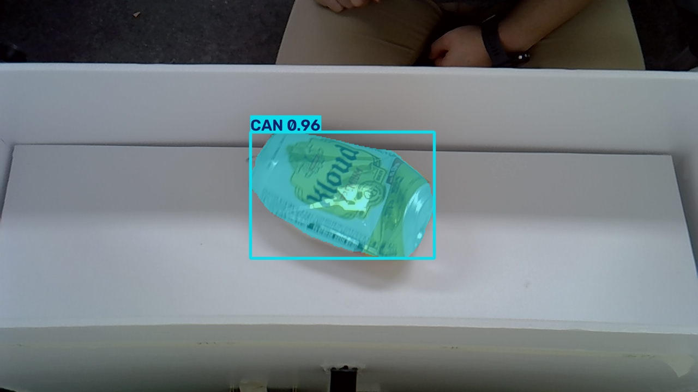
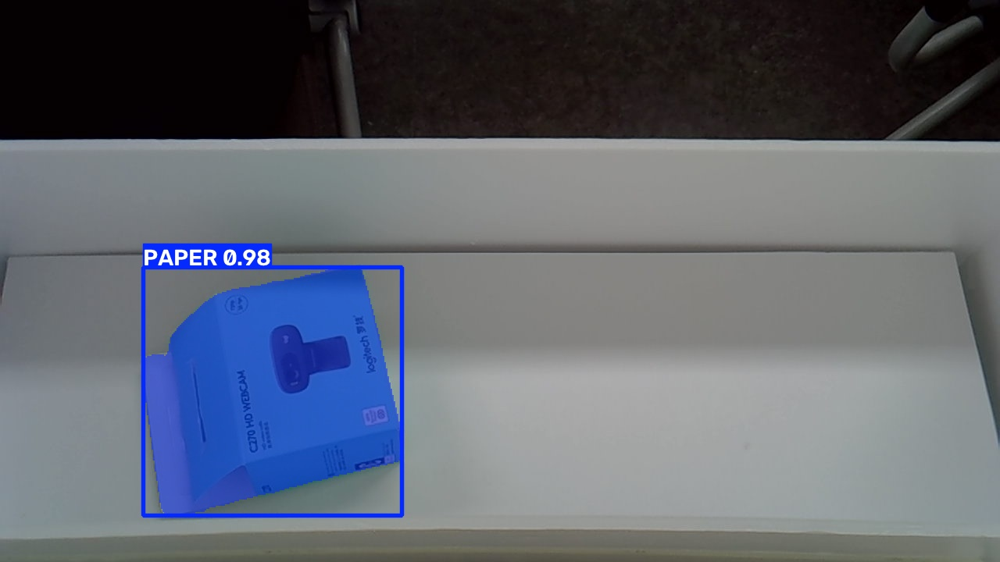
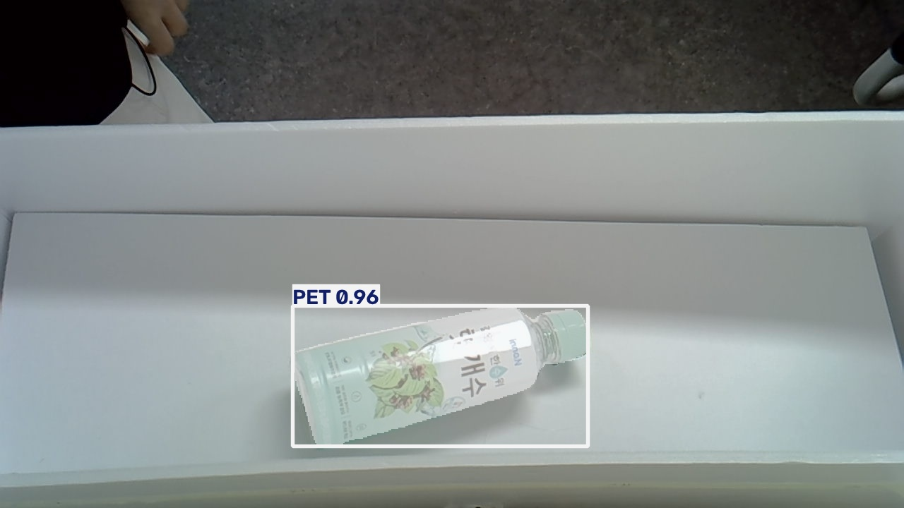
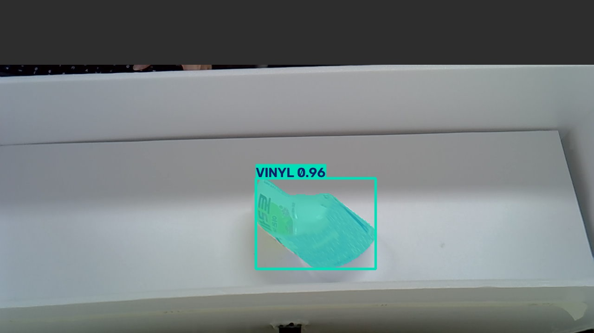

# AI 학습과 평가

[프로젝트 소개](../README.md) · [Jetson 실행](../edge_jetson/README.md) · [시스템 구조](../docs/architecture.md)

재질 검출과 PET 상태 검사를 분리해 학습·비교한 기록입니다. 아래 결과는 노트북에 저장된 출력이며 독립적인 재현 평가 결과는 아닙니다.

## 현재 런타임 구성

| 단계 | 설정 모델·입력 | 출력 |
| --- | --- | --- |
| 재질 검출 | YOLO11s, 640×640 RGB/NCHW, 0~1 | 클래스 점수·BBox |
| PET 라벨 | EfficientNet-B0, 224×224 RGB/NHWC, 0~255 | 라벨 있음 확률 |
| PET 내용물 | MobileNetV3-Small, 224×224 RGB/NHWC, 0~255 | 내용물 있음 확률 |

PET 검사는 독립적인 이진 분류기 두 개입니다. 단일 Multi-Label 모델이 아니며, Segmentation은 비교 실험에만 사용했습니다. 모델별 정규화는 분류 모델 그래프에 포함합니다.

기준은 [Jetson 설정](../edge_jetson/configs/config.py)과 [검사 구현](../edge_jetson/core/inspector.py)입니다. 저장소에는 배포 엔진이 없으므로 파일명에 지정된 모델과 실제 엔진 가중치의 동일성까지 검증한 것은 아닙니다.

## 설계와 실험

### 범용 데이터와 장치 환경의 차이

초기 YOLO11n 실험은 대용량 데이터를 Chunk 단위로 순차 학습하고 일부 Replay 샘플과 검증 결과를 보관하도록 구성했습니다. 발표자료에는 22만 장 이상 데이터 사용을 기록했습니다. 원본 데이터·학습 상태 파일은 저장소에 포함하지 않습니다.

일반 촬영 장면과 키오스크 내부의 배경·거리·조명 차이를 관찰하고, 장치 촬영 데이터를 포함한 YOLO11s 실험을 진행했습니다.

| 일반 촬영 장면의 검출 예 | 키오스크 내부 미검출 예 |
| --- | --- |
|  |  |

이 두 이미지는 개별 사례입니다. 서로 다른 평가셋에서 얻은 mAP 차이를 동일 조건의 개선율로 계산하지 않습니다.

### Detection과 PET 검사 분리

기구 분류와 PET Crop 추출에는 재질·위치 정보가 필요합니다. 운영 설정은 BBox 기반 Detection을 사용하고, PET에만 라벨·내용물 검사를 추가합니다.

| PET 검출 | 원본 BBox의 Crop |
| --- | --- |
|  |  |

분류 실험은 같은 입력 크기와 이진 분류부를 두고 MobileNetV3-Small·EfficientNet-B0·ResNet18을 비교합니다. Backbone은 고정하고 GAP → Dense 128 → Dropout 0.2 → Sigmoid 구조를 학습합니다.

## 저장된 평가 결과

### 재질 검출과 Segmentation

| 실험·출력 | 분할·수량 | mAP50 | mAP50-95 | 해석 범위 |
| --- | --- | ---: | ---: | --- |
| YOLO11n | Test 1,999장 | Box 54.4% | Box 41.2% | 대용량 데이터 실험 |
| YOLO11s | Validation 617장, all | Box 76.34% | Box 66.48% | 노트북에서 불러온 체크포인트의 저장 평가 |
| YOLO11s | 위 평가 중 old 463장 | Box 98.56% | Box 87.12% | 같은 평가의 기존 데이터 부분 |
| YOLO11s | 위 평가 중 new 154장 | Box 7.41% | Box 5.36% | 같은 평가의 추가 데이터 부분 |
| YOLO11s-seg | Validation 359장 | Mask 99.5% | Mask 94.28% | Segmentation 비교 실험 |

617장은 저장된 출력에서 **Validation**으로 확인됩니다. 해당 Detection 노트북은 학습 경로와 별도로 `model_specific_domain2` 아래의 체크포인트를 불러오는 셀이 있으므로, 저장된 평가가 직전 학습 산출물·배포 엔진과 같다고 단정하지 않습니다.

[발표자료](../docs/presentation/smart_recycling_final_report.pdf)의 YOLO11s 결과는 Train 1,791 / Validation 446장, mAP50 99.49%·mAP50-95 93.86%로 표기되어 있습니다. 이는 위 617장 평가와 다른 기록입니다. 실험·체크포인트를 확정하기 전 하나의 최종 성능으로 합치지 않습니다.

### PET 이진 분류

각 태스크 Test는 61장입니다. 양성은 라벨 또는 내용물 `있음`이며 평가 임계값은 0.5입니다.

| 태스크 | Backbone | Accuracy | Precision | Recall | F1 | FP / FN |
| --- | --- | ---: | ---: | ---: | ---: | ---: |
| 라벨 | MobileNetV3-Small | 98.36% | 96.88% | 100% | 98.41% | 1 / 0 |
| 라벨 | **EfficientNet-B0** | **100%** | **100%** | **100%** | **100%** | **0 / 0** |
| 라벨 | ResNet18 | 96.72% | 100% | 93.55% | 96.67% | 0 / 2 |
| 내용물 | **MobileNetV3-Small** | **91.80%** | **93.75%** | **90.91%** | **92.31%** | **2 / 3** |
| 내용물 | EfficientNet-B0 | 88.52% | 88.24% | 90.91% | 89.55% | 4 / 3 |
| 내용물 | ResNet18 | 88.52% | 90.63% | 87.88% | 89.23% | 3 / 4 |

굵은 모델은 현재 런타임 설정의 조합입니다. 라벨 EfficientNet-B0는 해당 Test 61/61, 내용물 MobileNetV3-Small은 56/61 정분류입니다. 이 표본의 결과를 다른 장치·조명에서의 무오류나 전체 시스템 정확도로 일반화하지 않습니다.

노트북의 자동 모델 선택 기준은 **Validation Macro F1 → 양성 Recall**입니다. 저장 출력에서 내용물의 자동 선택은 ResNet18이고, 현재 런타임 설정은 MobileNetV3-Small입니다. 검증 선택·Test 비교·운영 채택은 서로 구분해 읽어야 합니다.

### 평가 기준과 운영 판정

| 구분 | 라벨 | 내용물 |
| --- | ---: | ---: |
| 노트북 평가 | score ≥ 0.50이면 양성 | score ≥ 0.50이면 양성 |
| 현재 Jetson | score ≥ 0.30이면 불합격 | score ≥ 0.90이면 불합격 |

예를 들어 내용물 점수 0.535는 노트북에서는 양성이지만 현재 운영 임계값에서는 그 검사만으로 불합격이 되지 않습니다. 단일 사진의 예측과 평가 지표를 운영 임계값의 성능으로 그대로 옮기지 않습니다.

검사 엔진 미로드 시 BYPASS, 작은 Crop의 검사 생략 경로도 있으므로 실기기 평가에는 엔진 활성 상태와 Crop 조건을 기록해야 합니다.

## 데이터 분할과 전처리

저장된 노트북 출력에서 확인한 구성입니다. 원본 데이터 파일을 다시 집계한 값은 아닙니다.

| 실험 | Train | Validation | Test |
| --- | ---: | ---: | ---: |
| YOLO11s 통합 데이터 | old 1,780 + new 633 | old 463 + new 154 | 저장된 실행에는 없음 |
| YOLO11s-seg | 1,462 | 359 | 저장된 실행에는 없음 |
| PET 라벨 | 290 | 61 | 61 |
| PET 내용물 | 293 | 62 | 61 |

- Detection·Segmentation: 클래스 이름을 기준으로 ID를 재매핑하고 라벨·좌표·EXIF 방향·중복 이미지를 점검합니다.
- PET: 파일 SHA-256 기준 중복을 묶어 태스크 간 동일 이미지가 같은 분할에 속하도록 구성합니다. 병 개체·촬영 세션 단위 분할은 아닙니다.
- YOLO11s·Segmentation: 학습 832×832, 평가·고정 ONNX 내보내기 640×640 설정입니다.
- PET: RGB 224×224, 모델별 정규화, 학습 증강은 수평 반전·작은 회전을 사용합니다.
- 초기 YOLO11n 클래스 순서는 PET/CAN/PAPER/VINYL입니다. 최종 런타임의 PAPER/CAN/PET/VINYL과 다르므로 가중치를 교체할 때 순서를 확인합니다.

## 노트북과 재현

| 노트북 | 내용 |
| --- | --- |
| [yolon_wholedata.ipynb](yolon_wholedata.ipynb) | Chunk 학습·Replay·가중치 보관, 최종 Test·ONNX 내보내기 |
| [specific_domain_yolos_detect.ipynb](specific_domain_yolos_detect.ipynb) | 데이터 병합·EXIF 검토, YOLO11s 학습·소스별 평가 |
| [yolos-seg_model.ipynb](yolos-seg_model.ipynb) | Polygon 검증·Segmentation 학습·평가 |
| [multilabel_model.ipynb](multilabel_model.ipynb) | 두 독립 태스크의 Backbone 비교, 분할·지표·ONNX 결과 비교 |

노트북의 데이터 ZIP·결과 경로는 Colab/Drive 실험 환경에 맞춰져 있습니다. 재현에는 원본 데이터, 분할 manifest, 선택한 체크포인트, 라이브러리 버전, 클래스 순서, 입력·임계값이 필요합니다. YOLO11n 노트북은 앞선 Chunk 결과를 이어받는 구성이므로 초기 상태를 별도로 준비해야 합니다.

PET 노트북에는 Keras와 ONNX의 검증 샘플 출력 비교 코드와 저장 평가가 있습니다. 이것이 TensorRT 변환 후 타깃 정확도·속도의 검증을 대신하지는 않습니다.

Segmentation 시각 결과

| 캔 | 종이 | PET | 비닐 |
| --- | --- | --- | --- |
|  |  |  |  |

[엔진 배치와 실행 조건](../docs/getting-started.md#1-모델-준비) · [파이프라인 구현](../edge_jetson/README.md)
