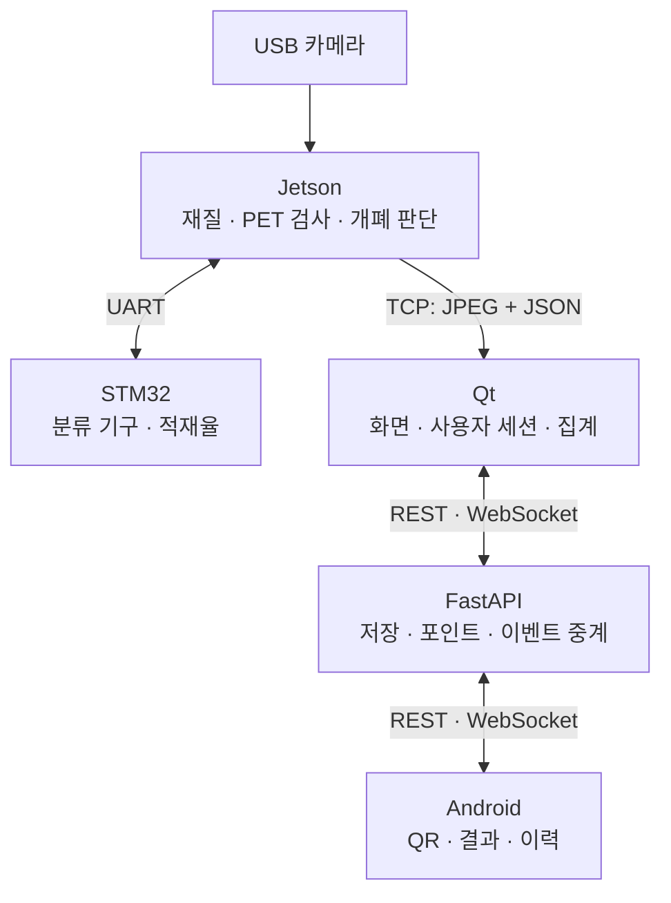
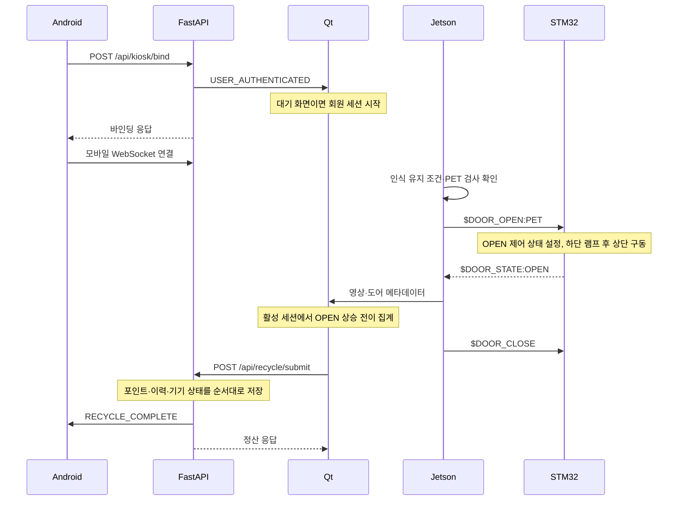

# 시스템 아키텍처

[문서 목록](README.md) · [실행 안내](getting-started.md) · [통신 규약](protocol-spec.md)

## 구성과 책임

실행 시스템은 Jetson, STM32, Qt, FastAPI, Android의 다섯 영역입니다. `ai_models/`는 이들과 별도로 학습·평가·모델 내보내기를 수행합니다.

**기구 제어와 사용자 정산은 별도의 흐름입니다.** 현재 Jetson 자동 개폐는 Qt의 로그인·배출 세션 활성 여부를 입력받지 않습니다. Qt가 세션 중일 때만 도어 상태를 집계하고 결과를 제출합니다.

| 영역 | 입력 | 출력·책임 | 진입점 |
| --- | --- | --- | --- |
| Jetson | 카메라 프레임, UART 상태, 선택적 TCP 제어 명령 | 검출·검사, 개폐 명령, 영상·메타데이터 | [main.py](../edge_jetson/main.py) |
| STM32 | UART 명령, 초음파 Echo | PWM, 도어 제어 상태·적재율 | [Main](../mcu_firmware/main.c) |
| Qt | TCP 프레임, 서버 이벤트, 사용자 조작 | 화면 전환, 수량·보상 집계, 정산 요청 | [MainWindow](../pc_dashboard/ui/mainwindow.cpp) |
| 서버 | REST 요청, WebSocket 연결 | DB 저장, 계정 포인트 갱신, 기기별 이벤트 | [main.py](../server/main.py) |
| Android | QR·딥링크, REST 응답, 서버 이벤트 | 연결·완료·이력 화면, 로컬 세션 | [MainActivity](../mobile_app/app/src/main/java/com/hocheol/smartrecyclingedgeai/MainActivity.kt) |

## 실행 컨텍스트

| 영역 | 실행 방식과 공유 상태 |
| --- | --- |
| Jetson 카메라 | 캡처 스레드가 최신 프레임을 교체하며 Lock으로 참조 접근을 보호합니다. 메인 루프는 새 프레임을 기다리지 않고 최신 참조를 읽습니다. |
| Jetson UART | RX 스레드가 개행 메시지를 읽고 Lock으로 적재율·도어 상태 캐시를 갱신합니다. |
| Jetson 메인 | 검출 → PET 검사 → 도어 FSM → JPEG·TCP 전송을 순차 수행합니다. TensorRT는 비동기 API를 호출한 뒤 엔진 실행마다 동기화합니다. |
| STM32 | USART2 ISR이 한 줄을 조립하고, 메인 Super Loop가 명령 해석·서보 갱신·센서 보고를 수행합니다. SysTick ISR은 1ms tick을 증가시킵니다. |
| Qt | 별도 QThread 분리 없이 QObject의 이벤트 루프에서 수신 파싱·JPEG 디코딩·UI 갱신을 처리합니다. |
| 서버 | ASGI 비동기 요청 처리와 aiosqlite를 사용합니다. 요청별 DB 연결을 만들며, WebSocket 룸 접근은 asyncio.Lock으로 보호합니다. |
| Android | ViewModel Coroutine과 Flow로 상태를 전달합니다. OkHttp가 WebSocket 콜백을 제공하고 DataStore가 사용자 정보를 저장합니다. |

카메라 캡처와 추론 반복 횟수는 다를 수 있습니다. 전송이 느리면 메인 루프의 `sendall`도 대기할 수 있으므로, 전체 경로를 완전한 비차단 파이프라인으로 보지 않습니다.

## 데이터의 계산 주체

| 데이터 | 기준·계산 위치 |
| --- | --- |
| 품목 ID | 최종 검출 설정의 `0=PAPER, 1=CAN, 2=PET, 3=VINYL` |
| 검출 위치·검사 점수 | Jetson. BBox는 원본 영상의 `[x1, y1, x2, y2]` 좌표 |
| 적재율 | MCU. 현재 설정은 빈 통 38cm·가득 찬 통 8cm 기준 |
| 도어 상태 | MCU 내부 제어 상태. Jetson이 최근 명령 품목을 덧붙여 Qt에 전달 |
| 세션별 수량 | Qt. 활성 세션에서 수신한 도어 상태의 OPEN 상승 전이를 집계 |
| 획득 포인트·탄소 환산량 | Qt의 `ITEM_METAS`로 계산한 뒤 서버에 제출 |
| 계정 잔여 포인트·배출 이력 | 서버의 SQLite |
| 앱 보유 포인트 캐시 | REST 조회·차감 응답 등을 DataStore에 반영 |

Qt의 품목별 설정값은 종이 30P/8.5g, 캔 50P/25g, PET 50P/15.2g, 비닐 10P/5g입니다. 탄소량은 프로젝트 내부 환산값이며 실제 환경 효과를 계측한 수치가 아닙니다. 앱 홈의 포인트 기반 환산과 마이페이지의 이력 합산은 계산 방식이 다릅니다.

## 정상 이용 흐름

Qt는 완료 버튼을 누르면 로컬 결과 화면을 먼저 표시하고 REST를 요청합니다. 서버 성공 응답을 기다린 뒤 결과 화면으로 전환하는 구조는 아닙니다. 서버도 Qt 화면 전환 완료를 ACK로 확인하지 않습니다.

### Jetson 개폐 판단

- 닫힘: 같은 후보가 1초 이상 유지되고 유효 프레임이 15개 이상이면 개방합니다. 최대 3회의 연속 누락은 후보를 보존합니다.
- 열림: 개방 명령 송신 성공 시점부터 3초가 지난 뒤 같은 품목이 연속 30회 검출되지 않거나, 명령 후 10초가 지나면 닫힘을 요청합니다. 같은 품목이 다시 검출되면 부재 카운터를 초기화합니다.
- 품질 검사: 최고 신뢰도 객체의 검사 결과가 불합격이면 자동 개방 후보에서 제외합니다.
- FSM은 유효한 카메라 프레임을 처리할 때 갱신합니다. 프레임을 읽지 못하면 타이머 판단도 건너뛰므로 독립적인 watchdog은 아닙니다. 프레임 카운터 역시 고유 캡처 수와 다를 수 있습니다.

### MCU 구동과 Qt 집계

MCU는 하단 두 축의 `Servo_Is_Moving()`이 모두 false가 되면 상단을 움직입니다. 이는 소프트웨어 램프 완료 판단이며 위치 센서의 확인은 아닙니다. `OPEN` 상태는 개방 명령 처리 시 설정되므로 실제 상단 도착보다 먼저 보고될 수 있습니다.

MCU의 2초 닫힘 보류·10초 자동 복귀도 개방 명령 처리 시점부터 계산합니다. Super Loop에서 조건을 확인하므로 센서·UART 폴링 시간만큼 처리가 늦어질 수 있습니다.

Qt는 세션 시작 시 이전 도어 상태를 CLOSED로 초기화합니다. 따라서 첫 수신 상태가 이미 OPEN이어도 품목을 알 수 있으면 한 번 집계하며, 연결 중단 중 놓친 개폐 이력은 복원하지 않습니다. 실제 낙하·한 번에 넣은 물체 수를 확인하는 센서는 없고, 시리얼 가상 모드도 같은 집계 경로를 사용합니다.

## 취소·연결 종료

- Qt 또는 앱의 취소 요청을 받으면 서버가 키오스크 상태를 IDLE로 저장하고 양쪽에 `SESSION_CANCELLED`를 보냅니다.
- 취소 이벤트는 사용자 화면·집계 세션을 종료합니다. MCU를 정지시키거나 Jetson 자동 개폐를 중단하는 명령은 아닙니다.
- WebSocket은 `bin_id`별로 kiosk·mobile 소켓을 하나씩 보유합니다. 같은 역할의 새 연결이 들어오면 이전 소켓을 교체합니다.
- 룸은 프로세스 메모리에 있습니다. 여러 서버 프로세스 사이의 공유, 이벤트 재전송·재생은 구현하지 않았습니다.
- 바인딩은 사용자·기기 존재를 확인하지만 기기 점유권을 사용자와 영속적으로 묶거나 독점 잠금으로 관리하지 않습니다.

## 검증 범위와 후속 과제

| 현재 구현·확인 범위 | 후속 과제 |
| --- | --- |
| 제어 상태 전이로 수량 집계 | 실제 투입·도착 피드백과 집계의 대조 |
| 단일 SQL의 포인트 증감, 잔액 조건부 차감 | 중복 요청 식별, 포인트·이력·상태의 단일 트랜잭션 |
| 전화번호 기반 사용자 조회·생성 | 사용자 본인 확인, 기기·API 접근 권한 |
| 룸별 이벤트 전송 | 오프라인 복구, 정산 결과 재조회·전송 보장 |
| 메인 루프 FPS·추론 구간 표시 | 고유 캡처 프레임 수, 화면 표시까지의 지연·분포 측정 |
| 학습·ONNX 평가 출력 보관 | 평가 체크포인트와 배포 엔진의 대응 기록·타깃 재평가 |

동일한 정산을 다시 제출하면 별도로 적립됩니다. 포인트 commit 후 이력 저장에 실패하면 앞선 적립이 남을 수 있습니다. 이 경계의 서버 검증과 실제 하드웨어 통합 시험은 별도의 검증 단계로 다룹니다.
