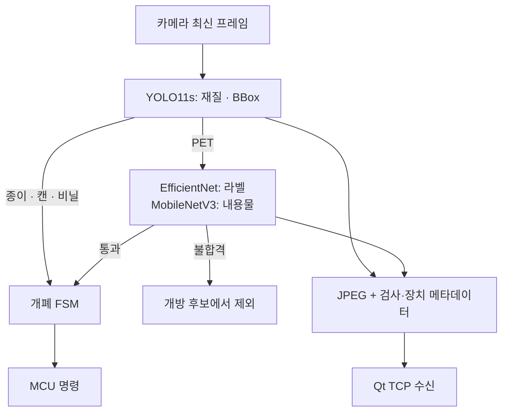

# Jetson 엣지 파이프라인

[프로젝트 소개](../README.md) · [전체 구조](../docs/architecture.md) · [통신 규약](../docs/protocol-spec.md)

카메라 프레임에서 재질을 검출하고 PET 상태를 검사합니다. 인식 유지 조건에 따라 MCU에 개폐 명령을 보내며, 영상과 상태를 Qt로 전송합니다.

## 처리 흐름



| 단계 | 입력·출력 |
| --- | --- |
| 재질 검출 | BGR 프레임 → Letterbox 640×640 → RGB/NCHW/0~1 → 클래스 점수·BBox → 신뢰도 필터·NMS |
| PET 검사 | BBox를 원본 영상 범위로 자르고 224×224 RGB/NHWC/float32/0~255로 입력 |
| 개폐 판단 | 최고 신뢰도 객체의 품목·검사 결과, 시간·프레임 카운터 |
| 전송 | JPEG와 JSON 메타데이터를 길이 헤더와 함께 한 메시지로 전송 |

검사기 두 개는 같은 해상도의 전처리 결과를 공유하지만 순차 실행합니다. 분류기 입력의 정규화는 내보낸 모델 그래프에 포함하는 구성입니다. 모델·데이터 비교는 [AI 문서](../ai_models/Readme.md)에 정리했습니다.

## 실행 구조

- [camera.py](core/camera.py): V4L2 캡처 스레드가 최신 프레임을 교체합니다. `read()`는 새로운 캡처를 기다리지 않으므로 동일 프레임을 다시 반환할 수 있습니다.
- [trt_engine.py](core/trt_engine.py): 초기화 때 pinned host/device 버퍼와 CUDA Stream을 만들고 주소를 바인딩합니다. 각 `execute()`는 비동기 복사·추론 후 동기화합니다.
- [serial_controller.py](stream/serial_controller.py): RX 스레드가 개행 메시지를 해석하고 장치 상태 캐시를 Lock으로 보호합니다.
- [main.py](main.py): 추론·검사·FSM·JPEG 전송을 순차 수행합니다. 전체 CPU 전처리와 패킷 생성까지 무할당인 구조는 아닙니다.

## 현재 설정

기준 파일: [configs/config.py](configs/config.py)

| 항목 | 값 |
| --- | --- |
| 카메라 요청 | 장치 0, 640×480, MJPG, 60 FPS, 수평 반전 |
| 검출 엔진 | `models/recycle_detect_yolo11s.engine` |
| 검출 기준 | confidence ≥ 0.80, NMS IoU 0.45 |
| 클래스 순서 | 0 PAPER / 1 CAN / 2 PET / 3 VINYL |
| 라벨 검사 | `pet_label_efficientnet.engine`, score ≥ 0.30이면 불합격 |
| 내용물 검사 | `pet_content_mobilenetv3.engine`, score ≥ 0.90이면 불합격 |
| 최소 Crop | 가로·세로 각각 40px |
| 자동 개방 | 같은 후보 1초 이상 + 유효 프레임 15개 이상 |
| 검출 누락 유예 | 최대 3회 연속 누락 동안 후보 보존 |
| 개방 후 닫힘 판단 | 명령 송신 성공 후 3초 경과 + 같은 품목 연속 미검출 30회, 또는 명령 후 10초 경과 |
| TCP | `0.0.0.0:9000`, JPEG quality 75, 소켓 timeout 1초 |
| UART | `/dev/ttyACM0`, 115200bps, timeout 0.1초 |

60 FPS는 카메라에 요청하는 값입니다. 장치가 수락한 캡처 모드와 실제 고유 프레임 수는 별도로 확인해야 합니다. UI의 `fps`는 메인 루프 간격, `infer_ms`는 검출·PET 검사 구간을 측정하며 화면 표시까지의 지연은 아닙니다.

## 예외 처리와 제어 범위

- 필수 검출 엔진이 없으면 초기화에 실패합니다.
- PET 엔진이 없거나 로드에 실패하면 해당 검사는 `BYPASS`로 통과 처리합니다.
- 너무 작은 Crop은 현재 메인 루프에서 검사 호출을 생략합니다. 검사 결과가 없는 검출도 FSM의 후보가 될 수 있습니다.
- 시리얼 비활성화·초기 연결 실패 시 가상 상태로 동작합니다. 실제 센서·모터 피드백과 구분해야 합니다.
- Jetson FSM 상태는 명령 송신 성공을 기준으로 바뀌며 MCU의 실제 도착 ACK를 기다리지 않습니다.
- TCP 수신기는 `OPEN`·`CLOSE` 수동 명령도 처리합니다. 현재 Qt 클라이언트에는 해당 송신 경로가 없고, 수동 개방은 자동 검사 조건을 거치지 않습니다.

FSM은 유효 프레임을 처리할 때 갱신하므로 카메라 읽기 실패 중에는 닫힘 타이머도 판단하지 않습니다. MCU는 별도로 개방 명령 처리 후 2초 닫힘 보류·10초 자동 복귀를 Super Loop에서 확인합니다. 실제 구동·집계 의미는 [전체 상태 흐름](../docs/architecture.md#정상-이용-흐름)을 참고합니다.

## 실행

타깃은 Jetson Orin Nano의 Linux/V4L2 환경입니다. TensorRT 10.x·CUDA·OpenCV와 Python 바인딩은 대상 장치에서 준비해야 합니다.

```bash
cd edge_jetson
python3 -m venv --system-site-packages .venv
source .venv/bin/activate
python -m pip install -r requirements.txt
python main.py
```

시스템 TensorRT를 공유하기 위해 `--system-site-packages`를 사용합니다. [requirements.txt](requirements.txt)는 Python 의존성을 명시하며 TensorRT·CUDA 자체를 설치하지 않습니다.

[모델 배치](../docs/getting-started.md#1-모델-준비)와 시리얼 포트를 확인한 뒤 실행합니다. PET 검사까지 확인할 때는 각 엔진의 ACTIVE 로그를 확인합니다. `q` 또는 SIGINT/SIGTERM으로 루프를 종료하면 자원을 정리합니다.

## 코드 안내

| 파일 | 책임 |
| --- | --- |
| [detector.py](core/detector.py) | Letterbox, 좌표 복원, confidence 필터·NMS |
| [inspector.py](core/inspector.py) | 품목별 검사기 선택, 점수·불합격 사유 |
| [door_controller.py](core/door_controller.py) | 후보 유지, 누락 유예, 개폐 타이머 |
| [protocol.py](stream/protocol.py) | UART 메시지·TCP 제어 명령 해석 |
| [socket_server.py](stream/socket_server.py) | 단일 Qt 연결, 프레임 송신, 명령 수신 |

[영상 전송 설계](../docs/troubleshooting.md#영상-전송과-화면의-분리) · [TCP·UART 필드 명세](../docs/protocol-spec.md)
