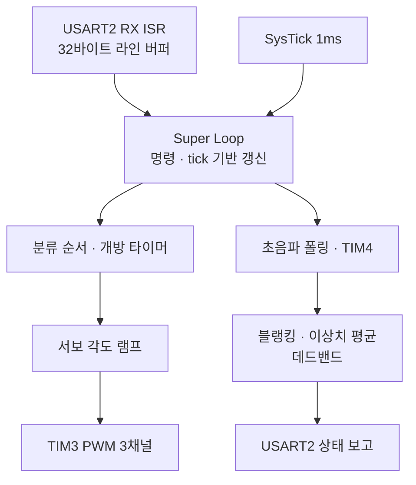
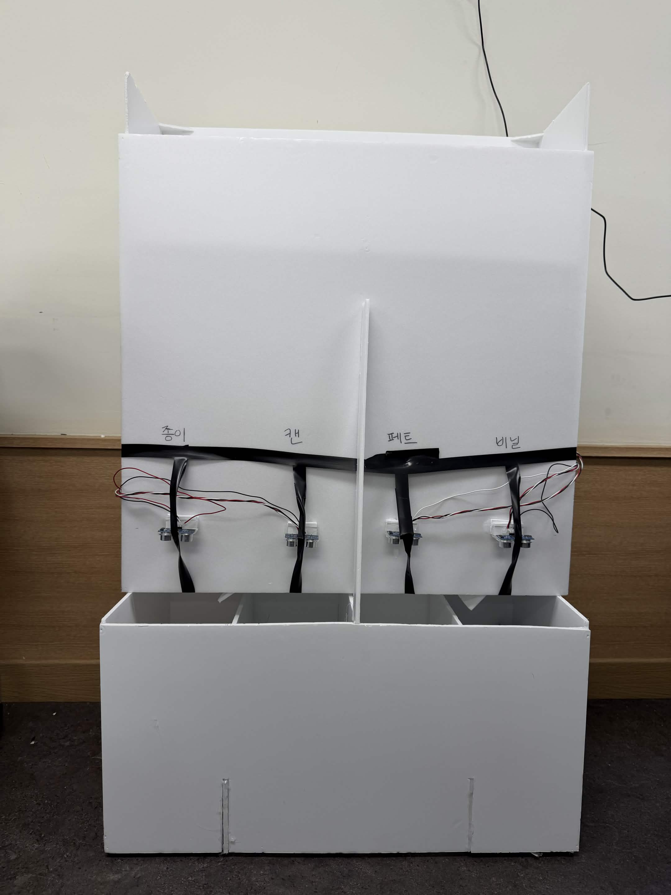

# STM32 분류 제어 펌웨어

[프로젝트 소개](../README.md) · [전체 구조](../docs/architecture.md) · [UART 규약](../docs/protocol-spec.md#uart-jetson--stm32)

STM32F411xE에서 3축 서보 분류 기구와 초음파 4채널을 제어하는 Bare-Metal C 펌웨어입니다. USART2 RX ISR은 명령 한 줄을 조립하고, Super Loop가 명령 처리·각도 램프·상태 보고를 수행합니다.

## 실행 구조



초음파 Echo 대기와 UART 출력에는 폴링 대기가 있습니다. Super Loop 전체가 비차단이거나 일정한 실행 주기를 보장하는 구조는 아닙니다.

## 클럭과 핀맵

기준: [clock.c](clock.c), [option.h](option.h), [timer.c](timer.c), [ultrasonic.c](ultrasonic.c)

| 항목 | 현재 구성 |
| --- | --- |
| 클럭 | HSI 16MHz → PLL SYSCLK/HCLK 96MHz, PCLK1 48MHz, PCLK2 96MHz |
| 타이머 | APB1 타이머 96MHz 기준. TIM3 PWM 50Hz, TIM4 카운터 1µs |
| 시스템 tick | SysTick 1ms |
| TIM3 CH1 / PC6 | 상단 도어. 논리 각도 30° 종이·캔 / 90° 중립 / 150° PET·비닐 |
| TIM3 CH2 / PC7 | PET·비닐 분류판. 논리 각도 130° PET / 30° 비닐 |
| TIM3 CH3 / PC8 | 종이·캔 분류판. 논리 각도 150° 종이 / 50° 캔 |
| USART2 / PA2·PA3 | TX·RX, 115200bps 8N1, Jetson 통신·표준 출력 |
| USART1 / PA9·PA10 | TX·RX, 115200bps, `Dbg_Log` 디버그 출력 |

| 수거함 | Trig | Echo |
| --- | --- | --- |
| 종이 | PC2 | PC3 |
| 캔 | PC9 | PC12 |
| PET | PC4 | PC5 |
| 비닐 | PC10 | PC11 |

서보 펄스 범위는 0.5~2.5ms이며 현재 `SERVO_INVERT`는 세 채널 모두 활성화되어 있습니다. 위 각도는 코드의 논리 각도이므로 실제 기구 방향·장착 상태와 함께 확인해야 합니다.



*키오스크 기구와 4구역 수거함 외관. 제어 핀·각도는 위 표의 코드 설정을 기준으로 합니다.*

## 분류 순서와 상태

[recycle.c](recycle.c)는 품목에 맞춰 하단 두 축의 목표를 설정한 뒤, 두 축의 소프트웨어 램프가 끝나면 상단을 구동합니다.

- 구동 속도: 120°/s
- 닫힘 보류: 개방 명령 처리 후 2초가 지난 뒤 CLOSE 요청 반영
- 자동 복귀: 개방 명령 처리 후 10초가 지나면 CLOSE가 없어도 중립 복귀 요청
- 닫힘 처리: 상단·하단의 중립 이동을 함께 요청
- 초기화: 기본 각도 설정 명령 사이에 busy-wait 지연 사용

`Servo_Is_Moving()`은 소프트웨어의 이동 진행 상태입니다. 실제 위치 센서는 없으며, `OPEN` 상태와 타이머 기준은 개방 명령 처리 시 설정됩니다. 따라서 `$DOOR_STATE`는 기구 도착 완료나 물체 낙하 확인을 뜻하지 않습니다. 타이머 조건은 Super Loop에서 확인하므로 폴링 대기만큼 늦게 처리될 수 있습니다.

## 적재율 처리

[bin_filter.c](bin_filter.c)의 필터는 힙 할당 없이 수거함별 정적 상태를 사용합니다.

| 순서 | 처리 |
| --- | --- |
| 1 | 해당 품목의 개방 명령 처리 후 2초 블랭킹 |
| 2 | 최근 5개 거리 샘플의 중앙값에서 ±5cm를 벗어난 값을 제외하고 평균 |
| 3 | 이전 적재율과 5%p 이상 차이가 날 때 갱신. 첫 유효 샘플은 바로 반영 |

메인 설정은 빈 통 38cm·가득 찬 통 8cm이며, 0~100%로 환산합니다. `$BIN` 보고는 약 2초 간격으로 계측·전송하므로 5개 샘플은 5개 루프 반복을 의미하지 않습니다.

Echo 상승 대기는 10ms, HIGH 유지 대기는 30ms에서 timeout을 반환합니다. 이 대기 동안 메인 루프의 서보 갱신·명령 처리가 지연될 수 있습니다.

## UART와 디버그

| 수신 명령 | 동작 |
| --- | --- |
| `$DOOR_OPEN:PET` | 지정 품목 분류·개방 요청. PAPER/CAN/PET/VINYL 지원 |
| `$DOOR_CLOSE` | 최소 개방 시간을 적용한 닫힘 요청 |
| `$BIN_RESET` 또는 `reset` | 필터 상태를 0%로 초기화 |
| `1 90 60` | 서보 1번을 논리 90°로 60°/s 이동 |

상태 변경 시 `$DOOR_STATE:OPEN` 또는 `CLOSED`, 약 2초마다 `$BIN:P/C/T/V`를 전송합니다. 표준 출력의 줄 끝은 CRLF입니다. USART2에는 일반 진단 문자열도 출력되며 Jetson은 인식 가능한 `$` 헤더를 선별합니다.

[isr.c](isr.c)는 SR→DR 읽기 후 바이트를 처리합니다. 단일 라인 버퍼가 처리 대기 중이면 뒤따르는 바이트를 버립니다. 큐·재전송·명령 ACK는 없습니다.

## 빌드와 플래시

[Makefile](Makefile)의 툴체인 경로와 GCC 라이브러리 버전을 설치 환경에 맞춥니다.

```makefile
TOOL_DIR = C:\arm-gnu-toolchain-15.2.rel1-mingw-w64-i686-arm-none-eabi
VERSION = 15.2.1
```

주요 옵션은 Cortex-M4, `fpv4-sp-d16`, hard-float ABI, GNU99입니다.

```powershell
cd mcu_firmware
make
make run
```

`make`는 `rom_0x08000000.elf/.bin` 등을 생성합니다. `make run`은 STM32CubeProgrammer CLI와 ST-Link/SWD를 사용해 플래시·리셋합니다. 현재 Makefile은 Windows 툴체인 경로를 기준으로 작성되어 있습니다.

플래시 후 시리얼 터미널에서 품목별 OPEN·CLOSE·수동 각도 명령을 보내 기구와 상태 출력을 대조합니다. 구문 검사·빌드 성공만으로 실제 전원·센서·모터 동작을 확인한 것은 아닙니다.

## 코드 안내

[main.c](main.c) Super Loop · [recycle.c](recycle.c) 분류 제어 · [servo.c](servo.c) 각도 램프 · [bin_filter.c](bin_filter.c) 적재율 · [uart.c](uart.c) UART · [crt0.s](crt0.s) 시작 코드

[제어·센서 설계 설명](../docs/troubleshooting.md) · [전체 구동 순서](../docs/getting-started.md)
