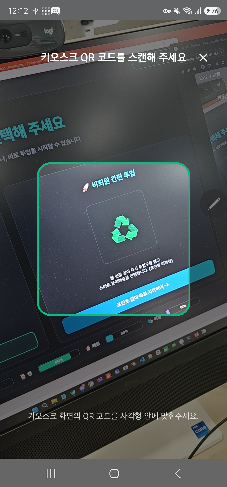
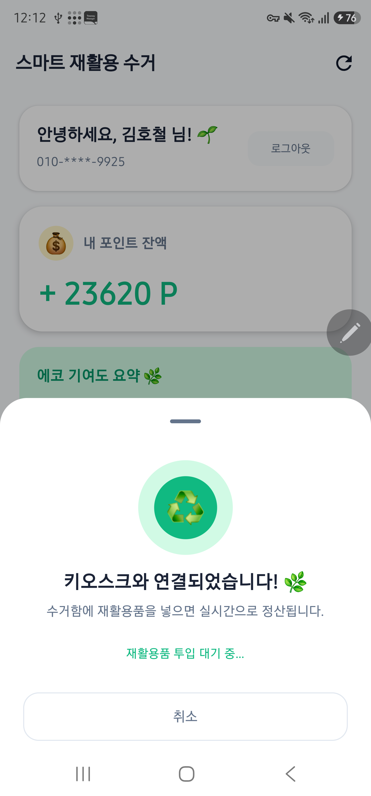
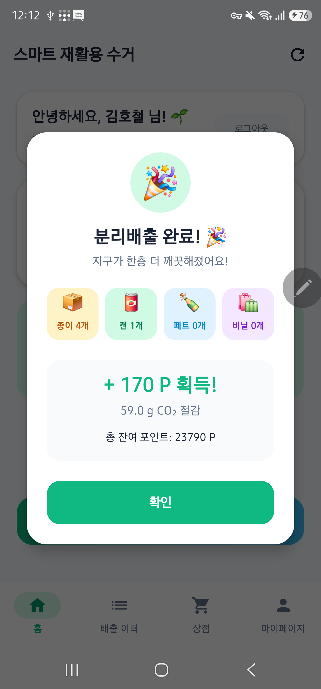
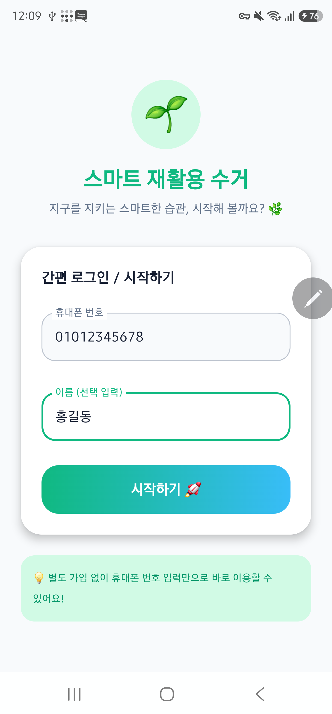
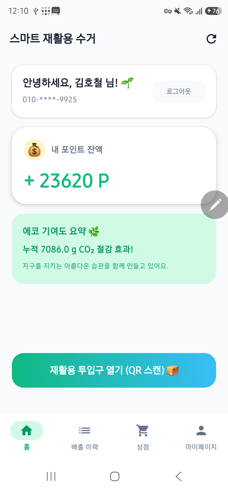
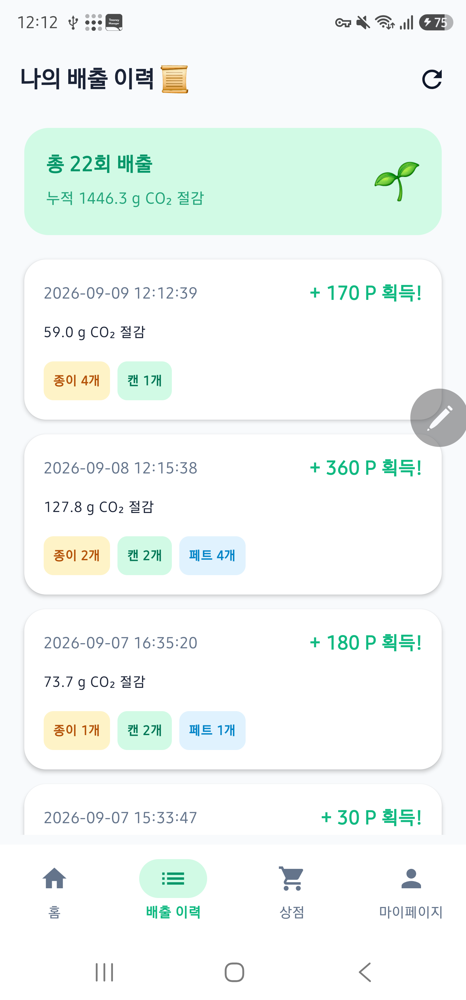
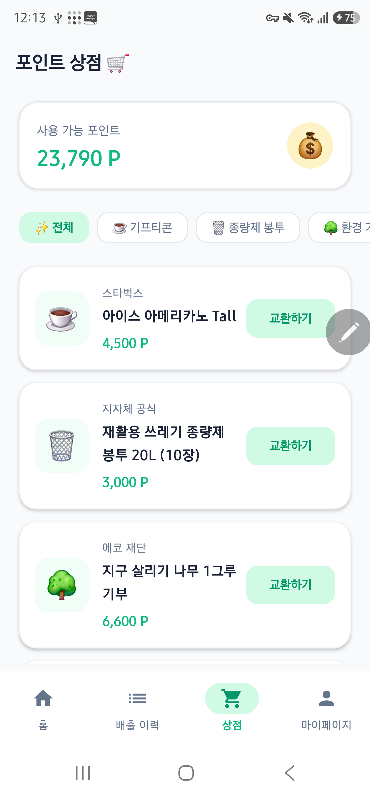
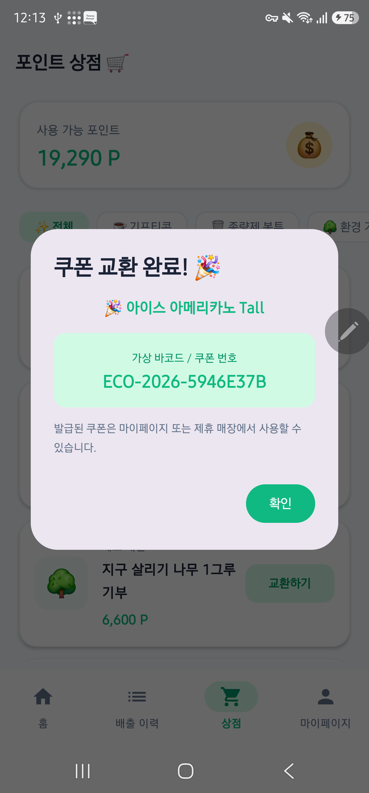
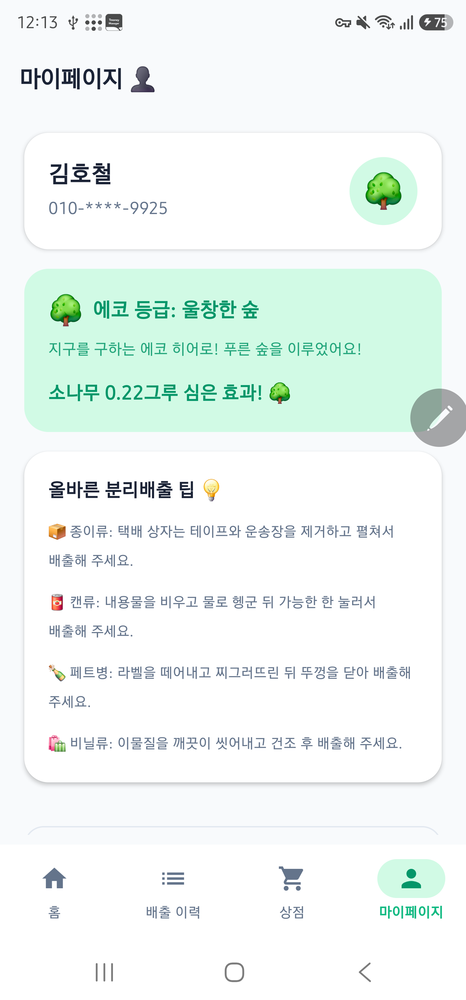

# Android 사용자 앱

[프로젝트 소개](../README.md) · [전체 흐름](../docs/architecture.md) · [서버 명세](../docs/protocol-spec.md)

Qt 키오스크의 QR을 스캔해 사용자를 연결하고, 배출 완료 결과·이력·포인트를 확인하는 Android 앱입니다. 포인트 사용 화면은 서버 차감과 로컬 쿠폰 시연을 연결합니다.

## 기능과 구현 범위

| 기능 | 구현 |
| --- | --- |
| 간편 로그인 | 전화번호·이름 REST 요청, DataStore에 사용자 정보 저장 |
| QR·딥링크 | CameraX·ML Kit 스캔, bin_id 파싱·바인딩 |
| 배출 세션 | 연결 안내, WebSocket 완료·취소 이벤트 수신 |
| 사용자 정보 | 보유 포인트·배출 이력 조회, 새로고침 |
| 포인트 상점 | 로컬 상품 목록, 서버 차감, 임의 쿠폰 문자열 생성 |
| 환경 기여 표시 | 프로젝트 내부 환산식과 배출 이력에 따른 등급·지표 |

상품은 `FakeShopDataSource`의 샘플이며 쿠폰은 UUID 기반 문자열입니다. 실제 제휴 상품·결제·사용 가능한 바코드·쿠폰 보관함을 구현한 것은 아닙니다.

## 상태와 데이터 흐름

```text
Compose 화면 → ViewModel → Repository → REST / WebSocket / DataStore
     ↑             │
     └── UiState · StateFlow
```

- ViewModel이 불변 데이터 클래스 형태의 UiState를 갱신하고 화면은 이를 수집합니다.
- Repository는 DTO를 화면에서 사용하는 모델로 변환합니다.
- `domain/model`에는 사용자·결과 모델과 환경 지표 계산이 있습니다. 별도 UseCase·Repository interface 계층은 없습니다.
- Hilt가 네트워크·저장소·Repository 의존성을 주입합니다.
- DataStore가 사용자 ID·이름·전화번호·포인트를 보관합니다. 인증 토큰을 저장하는 구조는 아닙니다.

## QR 연결과 완료

1. 앱 내부 스캐너 또는 `smartrecycle://kiosk/auth?bin_id=1`로 진입합니다.
2. 로그인 상태에서 바인딩 REST를 요청합니다. 로그인 전 딥링크는 `pendingDeeplinkBinId`로 보류하도록 구성했습니다.
3. 성공 응답 후 모바일 WebSocket을 연결하고 대기 화면을 표시합니다.
4. 완료·취소 이벤트를 받으면 연결을 닫고 화면을 갱신합니다.

CameraX는 `KEEP_ONLY_LATEST`를 사용하고 분석 이미지 처리가 끝나면 `ImageProxy`를 닫습니다. WebSocket 상태는 StateFlow, 완료·취소 이벤트는 SharedFlow로 전달합니다.

네트워크 실패 시 재연결을 예약하는 코드가 있으나, `connect()`와 재시도 Job의 취소 관계 때문에 `1 → 2 → 4초` 정책이 보장된 기능으로 설명하지 않습니다. 재연결 안정화·이벤트 복구는 후속 과제입니다.

## 주요 화면

| QR 스캔 | 키오스크 연결 | 배출 완료 |
| --- | --- | --- |
|  |  |  |

<details>
<summary>로그인·홈·이력·상점·마이페이지 화면</summary>

| 로그인 | 홈 | 이력 |
| --- | --- | --- |
|  |  |  |

| 상점 | 쿠폰 시연 | 마이페이지 |
| --- | --- | --- |
|  |  |  |

</details>

홈의 탄소 표시는 보유 포인트 기반 환산이고, 마이페이지는 이력의 탄소량을 합산합니다. 이력은 전체 목록을 조회하며 무한 스크롤 페이지 요청은 구현하지 않았습니다.

## 빌드와 실행

프로젝트에 선언된 버전은 [libs.versions.toml](gradle/libs.versions.toml)과 Gradle 설정을 기준으로 합니다.

| 항목 | 설정 |
| --- | --- |
| Android | minSdk 26, compileSdk·targetSdk 37 |
| Android Gradle Plugin | 9.4.0 |
| Kotlin Compose plugin | 2.4.10 |
| Gradle Wrapper | 9.7.1 |
| Gradle Daemon JDK | `gradle-daemon-jvm.properties`의 toolchainVersion 25 |
| Java 소스·타깃 | 11. Gradle 실행 JDK와 별도 설정 |
| UI·통신 | Compose BOM 2026.08.00, Retrofit 3.0.0, OkHttp 5.5.0 |

1. Android Studio에서 `mobile_app`을 엽니다.
2. [Constants.kt](app/src/main/java/com/hocheol/smartrecyclingedgeai/utils/Constants.kt)의 `BASE_URL`·`WS_BASE_URL`을 같은 서버 주소로 설정합니다.
3. SDK·JDK·Gradle Sync를 확인한 뒤 기기에 실행합니다.

```powershell
cd mobile_app
.\gradlew.bat assembleDebug
.\gradlew.bat installDebug
```

출력 APK는 `app/build/outputs/apk/debug/app-debug.apk`입니다. Manifest는 개발 서버 HTTP 연결을 위해 cleartext traffic을 허용합니다.

딥링크 진입 확인:

```powershell
adb shell am start -a android.intent.action.VIEW -d "smartrecycle://kiosk/auth?bin_id=1"
```

이 명령은 앱 진입을 요청합니다. 실제 바인딩·완료 확인에는 서버·Qt 연결이 필요합니다.

## 코드 안내

기본 경로: [app/src/main/java/com/hocheol/smartrecyclingedgeai](app/src/main/java/com/hocheol/smartrecyclingedgeai/)

| 위치 | 책임 |
| --- | --- |
| `MainActivity.kt` | 진입·딥링크·로그인 화면 분기 |
| `presentation/` | 화면별 UiState·ViewModel·Compose |
| `data/remote/` | REST 인터페이스·WebSocket 관리 |
| `data/repository/` | 요청·응답 변환·서버 연결 |
| `data/local/SessionManager.kt` | DataStore 사용자 정보 |
| `data/datasource/FakeShopDataSource.kt` | 시연 상품 목록 |
| `domain/model/` | 사용자·결과 모델·환경 지표 |

현재 저장소의 단위·계측 테스트는 기본 예제 테스트입니다. 실제 QR 인식 시간·재연결·화면 회전·다중 세션 동작을 검증하는 테스트 범위로 해석하지 않습니다.
