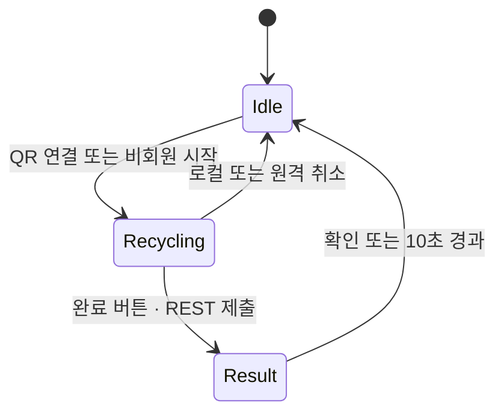
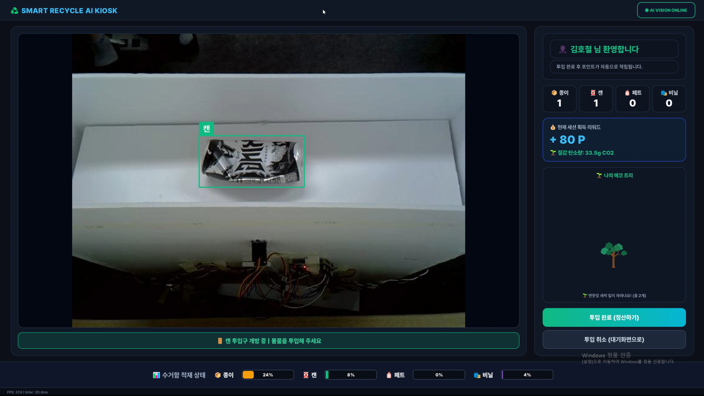
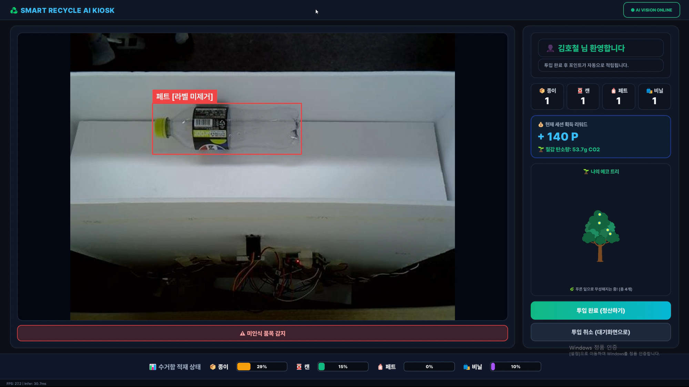
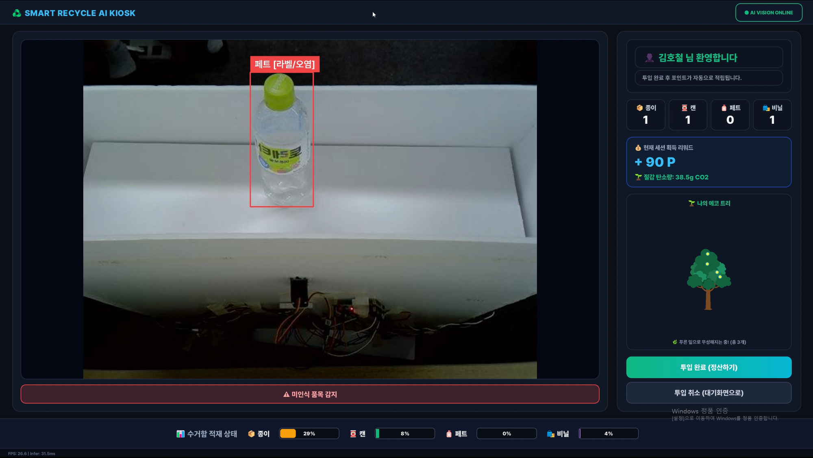

# Qt 키오스크

[프로젝트 소개](../README.md) · [전체 구조](../docs/architecture.md) · [TCP 규약](../docs/protocol-spec.md#tcp-jetson--qt)

Jetson의 영상·검사 결과와 MCU 상태를 표시하고, 회원·비회원 배출 세션을 집계하는 Qt Widgets/C++ 애플리케이션입니다. 서버와는 WebSocket 이벤트·REST 정산 요청으로 연결합니다.

## 화면과 사용자 흐름



| 화면 | 역할 |
| --- | --- |
| IdlePage | 키오스크 ID가 포함된 QR 생성, 비회원 시작 |
| RecyclePage | 영상·BBox·검사 사유, 도어 안내, 수량·보상, 나무 성장 표시 |
| ResultPage | 세션 결과와 보상 표시, 확인·자동 복귀 |

| 정상 인식 | 라벨 검사 불합격 | 내용물 검사 불합격 |
| --- | --- | --- |
|  |  |  |

이미지는 시연 화면입니다. 라벨과 내용물은 순차 경고 등급이 아니라 서로 다른 검사 태스크입니다. 현재 공통 경고 배너와 BBox 상세 사유의 표시는 [RecyclePage](ui/pages/recycle_page.cpp)를 기준으로 합니다.

## 영상과 상태 수신

[JetsonClient](network/jetson_client.cpp)는 QTcpSocket 데이터를 누적하고 `[JPEG 길이 4B][JSON 길이 4B]` 헤더를 읽습니다. 헤더·전체 페이로드가 도착한 뒤 JPEG와 JSON을 해석합니다.

- 길이 필드는 Big-Endian uint32입니다.
- Qt 수신 측 상한은 이미지 10MiB, JSON 64KiB, 누적 버퍼 20MiB입니다.
- 비정상 길이·버퍼 초과 시 버퍼를 비웁니다. 매직 바이트 기반 재동기화는 없습니다.
- QPixmap 디코딩·QPainter 오버레이는 UI 이벤트 루프에서 수행합니다.
- JSON은 `fromRawData`로 슬라이스 참조를 전달하지만, 이미지 디코딩·렌더링 전체가 Zero-Copy인 것은 아닙니다.

## 집계와 정산

[RecycleSessionController](controllers/recycle_session_controller.cpp)는 활성 세션에서 도어의 `CLOSED → OPEN` 전이마다 품목 수량을 한 번 증가시킵니다. MCU의 실제 도착·낙하 센서를 사용하지 않습니다.

세션 시작 시 이전 상태를 CLOSED로 초기화하므로, 첫 메타데이터가 이미 OPEN이어도 품목을 알 수 있으면 한 번 집계합니다. 연결 중단 중 놓친 개폐 이력을 복원하는 기능은 없습니다.

검출 누락 시 최대 3회 직전 표시를 유지하고, 정상 검출 25회 이상이면 확인 배너를 요청합니다. 이 카운터는 Jetson의 개방 조건과 별도이며, 도어 구동을 직접 결정하지 않습니다.

수량·포인트·탄소 환산량은 [app_config.h](configs/app_config.h)의 `SessionSummary`·`ITEM_METAS`에서 계산합니다. 완료 시 결과 화면을 먼저 표시하고 서버에 제출합니다. 서버 응답 실패의 사용자 안내·재시도·중복 제출 방지는 후속 과제입니다.

QR 영역 직접 클릭은 앱 없이 화면을 시연하는 경로입니다. 이 경로는 실제 서버 사용자 ID를 전달하지 않으므로, 회원처럼 표시되더라도 실제 계정 적립을 확인하는 용도로 사용하지 않습니다.

## 빌드와 실행

필요 모듈은 Qt `core, gui, widgets, network, websockets`와 C++17입니다. Qt 5.15 API를 기준으로 작성되어 있으며 Qt 6 호환 빌드는 별도 확인이 필요합니다.

1. [app_config.h](configs/app_config.h)의 Jetson·서버 주소와 키오스크 ID를 설정합니다.
2. Qt Creator에서 `pc_dashboard.pro`를 열고 해당 Qt Kit로 Build & Run 합니다.

MSYS2 UCRT64에서 Qt 5 개발 환경을 준비하는 경우:

```bash
pacman -S --needed \
    mingw-w64-ucrt-x86_64-gcc \
    mingw-w64-ucrt-x86_64-make \
    mingw-w64-ucrt-x86_64-qt5-base \
    mingw-w64-ucrt-x86_64-qt5-websockets
cd pc_dashboard
mkdir -p build
cd build
qmake-qt5 -v
qmake-qt5 ../pc_dashboard.pro "CONFIG+=release"
mingw32-make -j2
./release/pc_dashboard.exe
```

위 명령은 MSYS2 UCRT64 Bash 기준입니다. [Qt 5 패키지](https://packages.msys2.org/packages/mingw-w64-ucrt-x86_64-qt5-base)의 `qmake-qt5`를 명시해 Qt 6과 함께 설치된 환경에서도 버전 선택을 분명히 합니다. 버전 출력과 생성 Makefile의 실행 파일 경로를 확인합니다.

- `F11`: 전체화면·창 모드 전환
- `Esc`: 전체화면에서 창 모드로 복귀
- Pretendard는 시스템 글꼴을 사용합니다.
- QR 생성 라이브러리는 [Nayuki QR Code Generator](utils/qrcodegen.hpp)를 소스에 포함했습니다.

## 코드 안내

| 위치 | 책임 |
| --- | --- |
| [mainwindow.cpp](ui/mainwindow.cpp) | 화면·클라이언트·세션 시그널 연결 |
| [jetson_client.cpp](network/jetson_client.cpp) | TCP 수신·디코딩·메타데이터 전달 |
| [server_client.cpp](network/server_client.cpp) | 서버 WS 연결, 정산·취소 REST |
| [recycle_session_controller.cpp](controllers/recycle_session_controller.cpp) | 도어 전이 기반 집계·표시 상태 |
| [eco_tree_controller.cpp](controllers/eco_tree_controller.cpp) | 수량에 따른 애니메이션 구간 제어 |
| [pc_dashboard.pro](pc_dashboard.pro) | Qt 모듈·빌드 옵션·리소스 |

[전체 실행 안내](../docs/getting-started.md) · [통신 필드와 오류 처리](../docs/protocol-spec.md)
